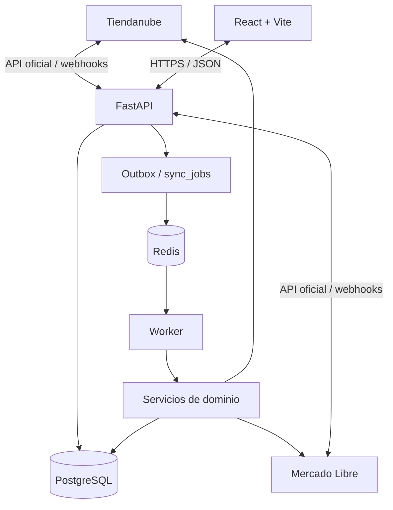

# Arquitectura

## Límites de responsabilidad

1. **API FastAPI:** recibe solicitudes del panel, callbacks OAuth y webhooks; valida y persiste rápidamente.
2. **Integrations:** encapsula autenticación, transporte HTTP, paginación, límites y contratos específicos de cada plataforma. No contiene reglas generales de negocio.
3. **Services:** contiene matching, inventario, reconciliación, movimientos y auditoría.
4. **Workers:** ejecuta trabajos fuera del ciclo HTTP. Redis será transporte/cola; PostgreSQL conserva la fuente durable del estado.
5. **Database:** modelos SQLAlchemy y migraciones Alembic.
6. **Frontend:** solo consume la API propia. Nunca conoce tokens de las plataformas.

## Diagrama de contexto

## Decisiones

- Monolito modular inicialmente: menos complejidad operativa que microservicios y límites claros para extraer componentes después.
- Esquema preparado para una sola tienda operativa, pero conserva `stores` para aislar datos y evitar rediseño.
- Toda cantidad se registra por variante, plataforma y ubicación externa.
- Los identificadores externos se guardan como texto para no asumir que ambas plataformas usan el mismo tipo o formato.
- Las operaciones remotas no se ejecutan dentro de una transacción SQL abierta. Se registra intención, se ejecuta la llamada y luego se persiste el resultado.
- Los eventos se guardan antes de procesarlos. El worker debe poder reanudar trabajos pendientes.
- No se considera que el timestamp de recepción sea la versión del inventario.

## Fuera del alcance de Etapa 1

OAuth, clientes HTTP reales, registro de webhooks en las plataformas, importación, escritura de cantidades, resolución automática de conflictos, login del panel y despliegue productivo.
